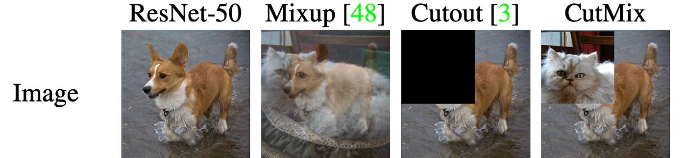

# Question #1

## Analytical thinking

### Problem description:

With the enforcement of the new EU AI Act, AI systems that process biometric data including face detection and recognition) are now subject to stricter transparency, risk management, and privacy-preserving requirements. In many real-world video analytics scenarios (smart cities, retail, sports analytics, workplace safety, and media processing), camera streams may capture identifiable faces even when identity is not required for the system’s core purpose. Under the new regulatory framework, this creates legal and operational risk unless appropriate safeguards are applied.

To address these constraints, we have designed a **face anonymization** solutuin based on a CNN-based face detector (YOLO-style architecture) to locate faces in images and video streams and automatically applies anonymization filters (blur, pixelation, or masking). The objective is to preserve scene utility while preventing personal identification, supporting privacy-by-design and privacy-by-default principles required by the EU AI Act.

However, deploying such a system in production raises several technical challenges: selective anonymization (only specific identities), fairness and bias in detection accuracy across demographics, robustness under difficult visual conditions, computational efficiency for real-time processing, and proper MLOps governance. This test explores how to analyze, diagnose, and improve such a Deep Learning–based anonymization system from both model and infrastructure perspectives.

  

In this test, we will analyze real problems and dilemas related with this product in order to evaluate how would you act and reason in front of them.

### Assumptions:
- Face detection is CNN-based and runs on images and video
- The system must comply with EU AI Act privacy and risk-control expectations
- There is no constraint in which model architecture can be used for both reidentification & depth estimation
- We want to reduce computational cost so the lighter the models, the better

### Questions:

Please provide a document (and extra data if any) answering each question below; please note that no practical exercises are required here (just theoretical analysis) but feel free to add any.

1. How can we improve face detection by adding **reidentification** to anonymize only specific individuals while keeping computational cost low?

I would focus on inference efficiency for this problem rather than training efficiency, they're separate problems, so I'd place reidentification strategically, limiting the number of times the model is called as much as possible while ensuring privacy.

Efficiency-wise, reidentification takes the bulk of the compute, since it relies on embeddings while detection is a single YOLO forward pass. Detection is only O(1) with respect to the number of faces, since the model processes the whole frame in one pass, while reidentification requires one embedding per detected face and O(Sxd) comparisons against a set S of protected identities with embedding dimension d. That says where cost grows, but I'd still profile it on the target hardware, throughput in it/s, peak memory and latency per stage in a table, since the constant factors decide whether it fits the frame budget. It also opens an optimisation: detection runs at batch size 1 because there is one frame, but embeddings don't have to, and since we already collect several crops per track before matching, they can be batched together instead of embedded one per frame, which keeps a small model from sitting underutilised.

To identify people in the scene, we need to extract an offline dataset with good-quality samples of the protected people. These samples should be embedded using a lightweight face-recognition model like MobileFaceNet with ArcFace. During live inference, every frame is passed through the detector and each detected face is associated with a UID. In subsequent frames, the detectors will find new faces and assign a different UID, and update bounding boxes whilst tracking every bbox coordinate from each face. When a new face appears in the scene, we'll immediately blur it because we do not know yet whether it belongs to the set of protected people. It'll remain blurred while we collect a few good-quality crops, embed and average them for robustness before comparing against the images in S. We do this for coverage, a single crop might be lateral profile and blurry in one frame and we also assume that the images on the set are also collected this way to prevent OOD comparison.

Furthermore, we compare the representation from the crops against the protected set. If it matches someone like José or Pepe, part of S, the identity is attached to the UID and so the associated bbox will get blurred. If it doesn't match anybody confidently we remove the blur after some time has passed. From that point forwards, the identity will be followed and the blur will stay for protected individuals, and so we don't need to recompute embeddings again on every frame. During the first frame, all people are new, and so every face is simply a new UID with no history, so reidentification for all people is only needed in this extreme case.

Then, the persons confirmed to be protected in the scene can be monitored occasionally for reidentification, either when tracking becomes abnormal, for example in motion statistics or appearance or when we trigger a random check every once in a while. If this happens we'll typically generate a fresh embedding and compare it against the currently associated identity with the track. This will just be O(d) instead of O(Sxd) and if verification fails, then the track will become unresolved and blurred, and just then we'll perform a full embedding comparison to establish that identity again.

If, when tracking, we lose a face, for example because José walked behind another person or around the corner, we should wait and keep the track for some time and try to recover it. Otherwise, we may have to create a new track which will prompt a new reidentification. José may walk behind or be close enough to another person who's not protected and the blur may follow the wrong person or we may be returning a single box. I'd treat this crossing as an event that triggers both tracks being blurred until a fresh embedding is generated to resolve which UID is which. The same happens if more than two people cluster together, causing blur switches, or both being protected.

2. How can we extend an anonymization pipeline with depth-based filtering to blur only background objects efficiently?

Here I would add depth as a separate filtering layer on top of the existing detection and tracking pipeline. We still detect and track faces every frame, and depth should never conflict with detection because a distant face that is never detected would never be blurred or tracked. The depth model (preferably Depth Anything v2 over MiDaS) can run at a much lower frequency than detection rather than every frame, and if cost is still a problem I'd choose a smaller variant rather than feeding it a smaller frame, since the ViT resizes to its own fixed input anyway.

If the camera doesn't move, I think there's no need to run the depth model every X, we can save the background as a depth map computed once at the beginning, because the shape of everything that isn't moving is constant. For recomputing it, plain frame differencing isn't enough on its own, a cloud passing changes brightness across the whole frame without the geometry moving at all, so it's better to difference on edges rather than raw pixels since structure survives a light change. The harder case is the camera drifting slightly on its mount, which produces no visible event but quietly misaligns the map, so I'd also check whether fixed features in the scene still sit where they were when the map was built. Neither test catches everything, so a periodic refresh stays as the floor, taken when the frame is clear of people so nobody gets thrown into the background.

Furthermore, the logic for the detection and tracking algorithm remains unchanged, because, if the depth mask fails, then the output looks worse in quality, but a wrong identity decision can expose someone like Pepe, so protected identities should always remain blurred regardless of their estimated depth, and likewise a cleared person past the threshold is still blurred. We can also use two separate thresholds for entering and leaving the blurred state (like a margin), so a noisy depth estimate sitting near the boundary cannot flip the decision every frame, and adapt blur strength to the relative object's or face's pixel size rather than using one fixed value.

To tune the threshold, I'd probably make a criterion that makes sure that regions far enough away are treated as background. Depth Anything v2 doesn't provide distance, so the numbers are only relative inverse depth. So, for that reason, the system needs a real calibration step before deployment, that is, I'd walk someone to the boundary of the depth map where anonymization should start and record what the model outputs there, then set the threshold from that reading. If we truly need metres, there are models that approximate distance, however I wouldn't place a big emphasis since we only care about relative background erasure. I'd also make sure that when a protected identity enters foreground, the identity layer gets activated.

3. Imagine we have this case: our face detection system does not detect properly (bad accuracy) dark-skins nor bald-people; how would you improve system accuracy? 

I'd probably take my time to verify where the detector actually fails rather than assuming firsthand that the system needs retraining. I'd build a table of test cases, only bald, only dark-skinned, dark and bald, those groups mixed with other people, different lighting, poses, distances, so no combination is missed, and record the obtained metric, the expected result, and notes for each row. Around this I'd measure recall (TP rate) in each scenario separately, because a subgroup can look acceptable on its own but fail badly in combination.

I think this is also a bias problem, the original dataset of pre-trained YOLO may have simply trained on very few dark individuals. I'd suspect the issue being more prominent for dark-skinned than bald, because bald people are distributed more uniformly across racial groups. However, I'd also consider other causes, for example, the lighting may account for a large number of false negatives, and it may be an exceptional case to have dark people distributed the same way  across varying illumination conditions. So I'd probably leave both as two hypothesis, one being coverage in data caused by training bias, and the other one being mainly exposure or contrast.

Furthermore, I think it's worth inspecting the confidence scores on the detection head, to see if they're much lower than for other groups. We can re-tune the threshold down if that's the case. This may allow a small number of false positives, but I think it's not a big deal here because missing the face means the subject doesn't get anonymized if they remain on the protected set. I'd also run a full threshold sweep, a global one, to find the point that minimizes false negatives while keeping false positives at a comparable rate, similar in spirit to EER.

After doing this analysis, I would concentrate on reproducing particular lighting conditions that can reveal detection errors. I will center in exposure reduction, camera filters and settings, brightness, and will apply different configurations in scenes with real faces. The samples have to be unambiguous, if the light is so low that a human annotator can't see the face either, it's safer to discard the sample than keep it, otherwise the model learns a spurious correlation and starts firing on anything sufficiently dark.

For bald people the same logic holds, but this time to hair. If the model has learned a spurious association between hair and head, I'd break it with targeted augmentation, heads with hair, without hair, with hats, hoodies, helmets, so all of them have to be detected. And I will also revise how the annotation was done and whether it was inconsistent or not, I'd teach them annotation of the full head, because if we only capture the face, then a tattoo or a billboard ad can pass as faces, so better to crop exactly the same for every sample.

4. Imagine this other case: let's assume we have added several bald people imagery to our dataset and we still are not increasing the accuracy. What may be happening? How would you fix this? 

It's very possible the model is not learning anything from the additions at all. To verify this, I'd mix the old data with the new bald samples and track the loss and gradient norms on those samples specifically. If the loss is already low, the model finds them easy and there may be little new information to extract. If the loss stays high and does not improve, the samples may not be providing a useful training signal. I would then check whether they actually add coverage that was missing before, or whether they are too similar to what the model has already seen. The point is not to make the model see the same examples more often, but to determine whether the new samples contain information that can improve the decision boundary. A subgroup metric during training can also make a small improvement visible before looking at the final checkpoint.

I also think, and this is another point I discussed, that annotations may just be inconsistent targets and therefore the model doesn't have a chance to learn the pattern well. I'll set a specific full head criterion covering ears, hairline, jawline, everything. Otherwise there's contradictory learning signals. To further confirm, we can run inference on samples with only bald people, if the detector always look for a shortcut on the easiest solution which is everyday items, buttons, shirts and everything that fits the overall gradient, I'd implement CutOut or CutMix covering hair and other parts of the face, for big regularization gains. Before that though, I'd also run an explainability check, a sliding window with a patch around the cropped face and measure when confidence drops. The patch can be swept with position and size, stride, if it's random gaussian noise, black or grey, etc... That is just debugging a few samples so the extra compute for running inference repeatedly may be acceptable. Attention rollout could point at where to look first if it's a ViT detector, but I'd treat that as a hint rather than evidence, since the occlusion sweep is an actual intervention and a saliency map is only a correlation.

Moreover, I'd also investigate other factors that may be correlated such as lighting, glare, helmets, caps, or the characteristics of the image source.

The data being evaluated may also just be wrong.  I would build a test set with enough variation across the factors that could affect detection including pose, illumination, face size, camera/source, occlusion, and different bald subjects. If these factors are distributed independently, we can see whether the model actually generalizes or only improves on the specific conditions represented by the added training images. And also highlight how much does the decision boundary shift after training, comparing both the old model and the new model to inspect a meaningful change.

  

5. Which MLOPs infrastructure would you design to manage this system? Just provide a high-level design and which tools would you use.
Design

I would probably first define a pipeline, with each component being neatly defined rather than a single unified model. It would consist of detector, reidentification model and depth together with the protected-set schema, all versioned and verified. There's also problems if we switch encoders, the comparison has to be done with the same extractor, because if we upgrade the recognizer it will invalidate every previously enrolled identity and forces another embeddings pass, so migrations will be handled gracefully. The protected set can leak embeddings, if, for example, an attacker uses a model inversion attack, therefore, it's important the system has its own lifecycle with Fernet encryption, access-controlled and able to delete a single identity with proper erasure requests.

With regards to tools, I'd use ClearML Data for dataset versioning, which gives clear parent->child relationships between versions and that way we can test a particular portion and trace its timestamp and update the datasets as commits. I'd probably build the subsets from the table of test cases with clear hierarchy. I'd keep an on-premise architecture supposed to run on edge, because we're obviously handling PII. Models would run quantized in INT8 rather than in FP32, the subgroup checks from the test-case table have to be rerun on the quantized artifact and not only on the original checkpoint to verify failures. Inference would run on a mini computer like Jetson Orin Nano which has more headroom and memory, including GPU, and served through TensorRT to leverage the exact GPU architecture.  For experiment tracking I'd also lean with ClearML, for its traceability, shared compute management and team permissions, logging the full metrics, including TP, TN, FP, FN, IoU, etc... Roboflow for annotation, with the annotation convention versioned alongside the data, since changing the convention is silently changing the labels. For a camera, I'd choose CSI over USB, for low latency and less overhead.

In terms of hosting, it will be a self-hosted cluster orchestrated with K3s, which is light enough to run on the edge hardware itself rather than needing a full control plane, and keeps every node under our control. I'd define both a staging and production environment, within staging all bugs will be caught before production, and allows the system to incorporate new features without breaking the model. I'd also have a separate dashboard and collect health metrics, fragmentation of tracks, time to resolve, current tracks and every detail once the system is deployed.

As a remote biometric identification tool, this system falls into the high-risk category under Article 6(2) and Annex III of the EU AI Act. This classification mandates an active risk management strategy throughout development and deployment. Any failure to blur a protected identity poses a direct risk, requiring the dashboard to actively log failure rates and equip human reviewers to monitor system changes.

6. From end user POV, which techniques would you use to improve final solution user experience? 

The most visible thing to a user is fluency. On live video, micro-stutters are realistic once detection, reidentification and depth compete for the same board, the picture will lag and the experience degrades even when every model is doing its job. The pipeline has to hold a stable frame rate, it should only degrade under very specific circumstances, for example, the first frame contains a lot of new people to be recognized, so naturally it will lag a little bit. I also think the blur from Pepe or José (protected identities) shall not remain a static blob that follows each frame, it's possible that if the blob is small, some parts of the face may be visible, so either increase the size of the blob proportional to the detected face by some small value or add a leaving fading trace that disappears for every previous frame.

To hold that frame rate, detection, tracking and compositing stay on the synchronous path, while the depth map checks and the periodic re-verification embeddings run on background workers, so a heavy embedding pass can never stall the output stream. I'd enable real-time adjustments to blur strength and privacy boundaries directly in the active pipeline. The masking should blend cleanly into the video while allowing security to immediately identify whether someone is anonymized.

I'll bundle an application with GUI that anybody can use without training, with security having direct access to the footage. Inside the app, I'd build a separate assistant over the logs, alerts and event history, queryable in plain language. It wouldn't run on the Jetson, which is already saturated by the detection, reidentification and depth models, so the boards only ship logs and events to a separate machine on site, a laptop or a small server, where the assistant runs. That keeps the data on-premise for the same reason inference is, since nothing leaves the site, while keeping the language model off the hardware that has to hold frame rate. This can serve as a tool to catch any possible risks that a human couldn't catch alone.

7. (EXTRA) Provide a code snippet (practical example) on how would you implement any of these applications: reidentification or depth estimation, for face anonymization.

I have provided an example that can act as the skeleton or logic for the depth integration in depth_snippet.py file in Q_1 folder.

