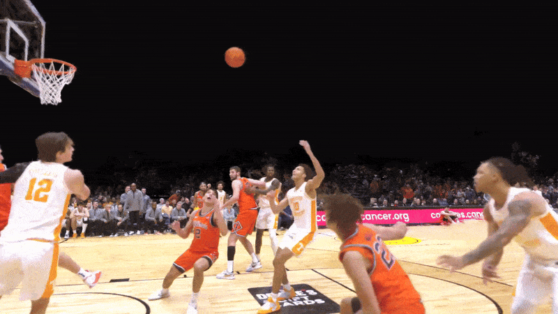

# Pose Estimation for Padel Hits — Analytical Reasoning Test

## Context

You are evaluating a Deep Learning system designed to detect padel hits using **pose estimation** from video. The model predicts player keypoints and derives hit events (forehand, backhand, smash, volley, serve) from body and arm motion. The system is already trained and partially deployed, but several performance and reliability issues have appeared in real scenarios.

  

### Assumptions:
- We want to reduce computational cost so the lighter the models, the better 

### Questions:
1. The model shows strong performance on validation data but fails on new matches recorded in different clubs with different camera heights and angles. Hit detection accuracy drops significantly.
 Explain the most likely root causes of this failure and describe how you would systematically investigate and isolate the problem.

It's quite possible the validation data has a very similar distribution to what was found during training, but real world data represents domain drift for the end-to-end model. For camera angle, specifically, this can happen if all padel recordings gathered during data collection come from one fixed point, and there's no guarantee it would work when the camera is set lower or higher. It would be worth performing some feature ablation anyway, take the trained model and, group by group, destroy each part of the input, because the problem may also be the image positions, joint angles, limb length ratios and more. If detection degrades, we can detect what the model latches on to predict and when the accuracy collapses.

I'd also place importance on frame continuity, limb lengths shouldn't change frame to frame and everything should stay proportionate without any jitter. It's important to also examine data distribution gaps between failed and working cases during training, measurable statistics like torso orientation, ball velocity, limb length ratios can help identify exactly why the accuracy drops, it could be that the player makes a passive relaxed pose when hitting the ball and the system misses it too. The detector crop also has to be big enough, since a tight box around a distant player leaves the pose model with too few pixels to localise wrists and elbows reliably.

Thinking about viewpoints first brought me to structure from motion (SfM), building a world coordinate frame and working in 3D, but that needs multiple views and here we only have one. What we do have is fixed geometry in the scene, so camera calibration is the more relevant tool, since we can still leave image coordinates by projecting onto the court plane. Intersecting the sidelines, baselines and service lines gives plenty of correspondences at positions we already know from the court spec, so I'd solve for the transform by direct linear transform with least squares over them, running RANSAC first to discard intersections that don't fit, since shadows and glass reflections produce spurious ones. The camera is static, so this is solved once at setup. What it buys is that a player's position and movement stop being a property of where the camera was placed and become a property of the court, so footage from a different club maps into the same frame. What it doesn't cover is anything off the floor, so a raised arm at contact still projects differently between a high and a low camera.

So in summary, the collection itself has to cover a range of camera heights and angles rather than one fixed point, and if the existing data is concentrated on a single viewpoint that's the gap to fill first. If the system has lots of samples from a specific viewpoint, have more diversity. Tracking the ball can also help here, since it follows a specific trajectory and it's clear when it stops and departs on a different one, which I think is a strong prior to consider. We could go even further, during data collection roll the camera in 360 degrees across varying heights and angles. Then use that footage to reconstruct the scene with 4D gaussian splatting, which also incorporates the temporal aspect, and render the same hits from viewpoints that were never physically recorded. This runs once during data preparation and never at inference, so the cost sits entirely offline.

  

2. After reviewing some samples, you discover that different annotators labeled keypoints slightly differently (especially wrists and elbows), and hit timestamps are sometimes shifted by a few frames.
 Analyze how inconsistent annotations affect both pose estimation and hit classification, how you would detect label-quality problems at scale and how you would decide whether to relabel, filter, or reweight parts of the dataset. Justify your decision criteria.

I'd keep clear track of which annotator produced which labels, and have them annotate the same footage under the same conditions. Then I'd train on each labelled set separately, same seed and hyperparameters, and compare. If one consistently produces a better model across several seeds, the difference isn't in the images but in how the labels were placed. If the gap sits inside the seed-to-seed variance, there's no finding yet and I wouldn't conclude anything from it.

That comparison gives a verdict but not an explanation, so alongside it I'd look at how each annotator's labels are actually distributed on the shared samples. Comparing where each one places wrists and elbows relative to the same visible anatomy shows whether the disagreement has a shape, a consistent displacement in one direction is a different problem from scatter in every direction, and only the first can be corrected without touching the images. Hit timing follows from the same overlap, since with both annotators on the same clips I can measure how many frames apart their marks are, which tells me they diverge even if it doesn't yet tell me who is right. Since the ball is already tracked, the impact can also be derived from its motion rather than from a human mark. The velocity vector reverses at contact, so the frame where the curvature of the trajectory peaks is a candidate ground truth, which is bounded by the capture rate since a fast smash can reverse between two frames.

To get direction rather than just disagreement, I'd use a set of clips already labelled and validated by a senior annotator, mixed into the normal work queue so annotators can't tell which ones are being measured. Because the correct labels exist for those clips, each annotator's error has a sign, so a consistent lead or lag in timing or a consistent offset on a joint can be subtracted rather than only detected. Over time the sampling accumulates like a Monte Carlo estimate: every annotator sees a random selection of validated clips, and the per-annotator, per-condition error rates converge from repeated draws instead of from one audit. The seed clips need rotating, otherwise they get recognised and stop reflecting normal work.

The main solution isn't to relabel everything. It's to learn from that measurement which conditions each annotator handles well, and route work accordingly, so the dataset accumulates the annotations each person is actually reliable at rather than replacing annotators or training on a single source. 

3. Smashes are rare in the dataset but very important for the product. The model often misses them while performing well on common hits.
 Without changing the model architecture, explain which dataset, training, and evaluation strategy changes you would consider. Here, the idea is to discuss tradeoffs and risks of each approach and how you would verify that improvements are real and not overfitting artifacts.

I think smashes is especially tough, because the hit happens under a relatively short time and it may be hard to catch a specific frame that looks exactly like a smash and not like any other serve or overhead. If it's commonly associated with another class, it'll be worth inspecting the logit distribution from the classifier, to determine where the uncertainty lies. It might just be that smashes are done very differently across varying samples and the system needs to learn this difficult variety through hard-negative mining or some curriculum. What is expected, from a good system, is to have smashes recognized but with lower probability (partly due to the rarity) and other types of hits competing against smash but more uniformly. However, if another class dominates, the likeliest reason is that it's simply far more frequent in the data, which points to an imbalance problem, though it could also be that it genuinely looks similar to a smash.

For training, I'd compose batches deliberately rather than randomly sampled, each batch holds different hit types but also a fraction of smashes above the natural rate, so that way the gradient contribution for the uncommon class is stronger. Since repetition alone doesn't create any variety, the sampling weight should follow how distinct an example is rather than how scarce its label is, so clips from different players, courts and cameras get drawn evenly. Before that, I'd rank each smash sample by the model's uncertainty and admit them gradually, starting with the confident ones so the noisy tail enters late rather than dominating early training. That same ranking supports an active learning loop for collecting more. If the model flags a couple of hundred clips from unlabelled footage as possible smashes and someone confirms which ones actually are, we find rare events without watching fifty hours of video, and the labels are correct because a human made them. Pure semi-supervised pseudo-labelling would be riskier here, since the model would be generating smash labels with a classifier that is already weak on smashes.

There's also a posible data problem, smashes being rare, means they appear less in the training data which will justify the lower performance, augmentation to adjacent frames could be done but I'd avoid relying on it too much, from frame to frame, the poses are nearly identical and it's possible the model regresses even, because now there's a chance it overfits to a particular scene. There's also the chance (though rare) that no frame ever exposes a full high quality pose of the smash and therefore training is contaminated by noisy samples. In that case the fix is on the capture side rather than the data side, recording at a higher frame rate so the impact instant actually lands on a frame. The trade-off is exposure, since shorter frames mean less light.

For evaluation, I'd keep a high quality natural-distribution test set to measure real world false positives and recall in the smash-enriched set, since very few test data for smashes may be too shallow to resolve any improvement. Also, per class metrics, and different matches for training and testing.

4. Two training runs with the same configuration produce noticeably different results. One model is stable but less accurate; another is more accurate but produces jittery keypoints and inconsistent hit timing.
 Provide a reasoning to decide which model is actually better for production. What additional tests, metrics, and scenario-based evaluations would you design to support the decision?

Before comparing anything I'd want to know where that variance lives, and two seeds can't tell me, so I'd run at least three per configuration and look at which part of the system is unstable rather than which run came out ahead. The pose stage and the classifier can be re-seeded independently, so it's worth isolating whether the variance comes from one of them or from both, since a system where the same configuration produces very different behaviour isn't finished regardless of which checkpoint gets shipped.

If I had to make a choice now, I'd take the jittery model. Its errors are fixable by interpolating part of the previous movement and they get averaged out. I'll test the fix and if it clearly shows stable movement without performance decrease we've pointed the fix, however is also very possible the model degrades (as the other checkpoint), in that case a fair diagnostic and possible hypothesis may surge, that is, the classifier fails under stable movement but succeeds under jittery and unstable movement. Then, this can serve as a possibility that the encoder only ever got fed bad poses and so the model did what it was taught to do, therefore placing the burden in the pose quality.

To further diagnose I'd have both models completely isolated, pose of one model goes to the classifier of the other model, and otherwise. This can give us a consistent picture, if both encoders perform well under jittery poses it might be that the model benefits from apparent irregular poses rather than clean ones, which might signal a regularization effect. However if they don't agree, for example simple encoder has worse performance with jittery and otherwise, it probably meant the gradients of the model affected the model pipeline end-to-end rather than separately. One caveat is that each classifier was trained on the pose output of its own encoder, so it has co-adapted to that encoder's noise. A drop in the crossed condition may reflect broken co-adaptation rather than either stage being worse, which is itself informative, a classifier that only works with jittery input is evidence it learned to expect jitter.

The decision itself has to come from hit detection, how many strokes each model gets right and how many frames off the true impact it lands, since that's what the product actually reports. Finally, MPJPE against stored ground-truth references is worth keeping as a secondary check, to see whether the jittery model deviates more or less from the reference, but pose error is an intermediate quantity and can move opposite to what the product actually delivers.

5. Which model would you propose for this application? Why?

I'd start from a baseline rather than committing to a training run. MediaPipe Pose is a strong first candidate: it runs comfortably above 30 FPS on CPU alone, which matters when the whole product is live video, and it gives 33 keypoints rather than the 17 of COCO-style models, so wrists, hands and feet are better covered. It's single-person by design, so a small YOLO detector runs first to find each player and MediaPipe runs on each crop, which for four players is a bounded and predictable cost. The open question is fine-tuning: the released checkpoints aren't really set up for it and there's an open GitHub issue about future support, so if padel footage turns out to be too far from what it was trained on, that's where the baseline stops.

Only if it does would I move to fine-tuning, and at that point I'd prepare the footage and fine-tune an existing pose checkpoint rather than train anything from scratch. YOLO26-Pose is the natural alternative to test against, since it handles multiple people in one pass, so the separate detector stage disappears and the crop step with it. The trade-off is fewer keypoints than MediaPipe's 33, which matters for the hands and feet coverage, so I wouldn't spend that effort until the baseline has actually failed on measured cases.

For the hit classifier, the input is the 33 keypoints and the joint angles between them, centred on the mid-hip, scaled by torso length and rotated so the shoulder axis is the reference direction. That removes where the player stands in the frame, how large they appear and how the body is rotated in-plane, though it doesn't remove camera elevation, since a hit seen from above still projects differently.  That representation feeds a small temporal model over a window whose length is specified in seconds and converted to frames using the source FPS, so it covers the same fraction of the swing regardless of the capture rate.

I'd also track the ball, not just the players. It disambiguates which player actually made contact when two are close together, and it separates a real hit from a swing that missed, which pose alone can't do. Combined with per-player tracking it's also what turns the system from a hit classifier into something that produces match statistics per player, which is where the product value is.

