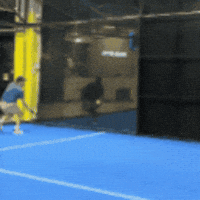

# Pose Estimation for Padel Hits — Analytical Reasoning Test

## Context

You are evaluating a Deep Learning system designed to detect padel hits using **pose estimation** from video. The model predicts player keypoints and derives hit events (forehand, backhand, smash, volley, serve) from body and arm motion. The system is already trained and partially deployed, but several performance and reliability issues have appeared in real scenarios.

  

### Assumptions:
- We want to reduce computational cost so the lighter the models, the better 

### Questions:
1. **The model shows strong performance on validation data but fails on new matches recorded in different clubs with different camera heights and angles. Hit detection accuracy drops significantly.
 Explain the most likely root causes of this failure and describe how you would systematically investigate and isolate the problem.**

La causa más probable es un domain shift geométrico. Si el conjunto de validación procede de las mismas grabaciones que el de entrenamiento (mismos clubes, mismas cámaras), el modelo no ha generalizado, ha memorizado lo que conoce. Una pose 2D no es invariante al ángulo de cámara: la misma acción proyectada desde otra altura genera coordenadas distintas y oclusiones diferentes. Si los matchs originales tenían siempre las mismas condiciones, las reglas aprendidas solo valen para la geometría original.

Además también hay causas secundarias como los cambios de iluminación y de fondo, diferencias de resolución y de tamaño del jugador en píxeles, y distinto frame rate, que cambia el número de frames que dura un golpe.

Para aislar el problema haría lo siguiente:

- Inspección visual: Superponer los keypoints predichos sobre el vídeo nuevo. Para tener una intución de dónde falla.
- Separar las dos etapas: El sistema tiene dos bloques (pose estimation y clasificación de golpes) y el fallo puede estar en cualquiera. Cogería un subconjunto pequeño del club nuevo y evaluaría la pose por separado. Si los keypoints ya son malos, el problema es de percepción, si son buenos y aun así fallan los golpes, el problema está en el clasificador.
- Aislar la variable: Comparar el rendimiento agrupando por club, por cámara y por condición de captura. Si la caída se concentra por ejemplo en las cámaras más altas, la causa es el ángulo, y si se reparte por igual, apunta más a iluminación o resolución.
- Test controlado: Sobre los datos originales, que sí funcionan, aplicar transformaciones intentando imitar el entorno del club nuevo y ver cuánto cae la métrica. Si cae de forma parecida, queda confirmado que la sensibilidad es geométrica y no de apariencia.

Por último, el propio hecho de que el fallo no se detectara antes ya es un diagnóstico en sí mismo. Si los splits se hicieron por frames aleatorios, frames del mismo partido cayeron en train y en validación, así que el modelo ya los había visto y la métrica salía buena sin significar nada. La validación debería estar dividida por club y por cámara para que mida realmente la capacidad de generalizar a una grabación nueva. 

Al margen del diagnóstico, añadiría augmentación geométrica en entrenamiento para cubrir el rango de alturas y ángulos esperable, y valoraría generar datos sintéticos, que permiten obtener el mismo golpe desde cualquier altura y ángulo de cámara a coste casi nulo, en lugar de ir a grabar a más clubes.

2. **After reviewing some samples, you discover that different annotators labeled keypoints slightly differently (especially wrists and elbows), and hit timestamps are sometimes shifted by a few frames.
 Analyze how inconsistent annotations affect both pose estimation and hit classification, how you would detect label-quality problems at scale and how you would decide whether to relabel, filter, or reweight parts of the dataset. Justify your decision criteria.**

En resumen: distinguir label noise sistemático de aleatorio -> medir el inter-annotator agreement -> relabel del test set -> corregir los sesgos de forma automática -> reweighting del ruido aleatorio -> filtrar solo lo irrecuperable.

Lo primero es distinguir el tipo de label noise existente. El aleatorio, cuando cada annotator se desvía en una dirección distinta, el modelo lo promedia razonablemente bien. Pero el sistemático es peor, porque si un annotator marca la muñeca en el hueso y otro en el centro de la mano, el modelo recibe dos definiciones contradictorias.

El impacto se concentra justo donde más molesta. Wrists y elbows son los keypoints con más varianza entre annotators (se mueven rápido y salen con motion blur) y son los que definen el golpe, así que el error se propaga al classifier. Además, si el classifier usa velocidades de la muñeca como feature, derivar amplifica el ruido. Y el desplazamiento temporal es incluso peor, porque un golpe dura pocos frames, así que un shift de 3 frames es una parte grande del evento.

Para detectar la label quality a escala:

- Doble anotación de una muestra pequeña, midiendo el inter-annotator agreement (normalizado por el tamaño del jugador). Ese número es el performance ceiling alcanzable, para descubrir si el problema son los datos o el modelo.
- Agrupar el error del modelo por anotador. Si uno destaca sistemáticamente no es ruido, es un annotator bias.
- Para el timing, comparar contra una señal objetiva como el audio. El impacto de la pala es un pico limpio que puede permitir estimar el offset de cada anotador sobre el dataset.
- Aplicar reglas de coherencia interna, la longitud del brazo no puede variar mucho entre frames consecutivos, ni los keypoints saltar bruscamente. Lo que las incumpla es candidato a error.
- Revisar a mano los high-loss samples, que muchas veces son etiquetas mal puestas.

Sobre qué hacer con los datos, el criterio depende de si el noise es sistemático o aleatorio, y de si está en train o en test:

- La prioridad es reanotar el test set, con un test ruidoso no se puede medir si un cambio mejora el sistema. 
- El noise sistemático se puede corregir automàticamente, midiendo la desviación media de cada anotador sobre el subconjunto de doble anotación y restándosela, sin necesidad de reanotar.
- El noise aleatorio y moderado lo dejaría en train, dandole menos peso en la loss para que el modelo le haga menos caso.
- Filtrar solo lo irrecuperable, y con cuidado: eliminaría los casos con muchas samples que no tengan sentido, procurando que no sean hard examples legítimos y que claramente sean errores. Y no filtraría en clases con pocos samples como los smashes, donde cada ejemplo vale mucho.

Como medida para prevenir, haría unas annotation guidelines explícitas para los puntos ambiguos (dónde va la muñeca, qué frame cuenta como golpe, etc) y haría overlap entre anotadores para mayor consistenciae.

3. **Smashes are rare in the dataset but very important for the product. The model often misses them while performing well on common hits.
 Without changing the model architecture, explain which dataset, training, and evaluation strategy changes you would consider. Here, the idea is to discuss tradeoffs and risks of each approach and how you would verify that improvements are real and not overfitting artifacts.**

Se trata de un problema de class imbalance: los smashes quedan diluidos y la loss está dominada por los golpes frecuentes.

Lo primero que cambiaría es la evaluación. El accuracy medio no sirve, hay que mirar el recall por clase y en concreto el de smash, porque en este producto un smash perdido cuesta mucho más que un falso positivo. Y hay que ampliar el test set de smashes, ya que con pocos samples el resultado no es representativo.

En los datos, oversampling de los smashes o class weights en la loss. Es barato, pero el riesgo es que si son pocos y siempre los mismos el modelo los memoriza en lugar de aprenderlos. Haría un data augmentation para diversificar, sobre todo temporal (variar la velocidad del clip), que es especialmente relevante aquí porque un smash es un golpe rápido. Y en el mejor de los casos, recolectar más smashes reales. 

En el training, transfer learning: partir de un modelo de pose preentrenado y hacer fine-tuning con los datos de pádel, porque así el modelo no tiene que aprender qué es un cuerpo humano y hacen falta muchos menos ejemplos de cada golpe. Y focal loss o hard example mining, para que el gradiente no lo dominen los casos fáciles.

Para verificar que la mejora es real y no un artefacto de overfitting:

- Split por partido y no por frames, para que los mismos smashes no estén en train y en test.
- Intervalos de confianza, porque con pocos samples una subida puede ser ruido.
- Comprobar que el recall de las clases comunes no ha empeorado (trade-off típico del oversampling).
- Validar sobre un test set de smashes que no se haya usado.

Por último, si el smash queda como el peor caso pese a todo, es preferible bajarle el umbral de decisión solo a esa clase y asumir más falsos positivos, ya que en este producto revisar un golpe mal clasificado es más fácil que recuperar uno que no se detectó.

4. **Two training runs with the same configuration produce noticeably different results. One model is stable but less accurate; another is more accurate but produces jittery keypoints and inconsistent hit timing.
 Provide a reasoning to decide which model is actually better for production. What additional tests, metrics, and scenario-based evaluations would you design to support the decision?**

Primero habría que ver con qué métrica se ha decidido que uno es más accurate. Si es el error de pose por frame, está midiendo la etapa intermedia y no lo que interesa, que es detectar el golpe. Y aquí el error se propaga, si el classifier usa la velocidad de la muñeca, unos pocos píxeles de jitter se convierten en un pico de velocidad grande y en un golpe detectado en el frame equivocado. Por eso un modelo más preciso de media puede ser peor.

Así que compararía los dos con precision y recall de detección de golpes. Y con una tolerancia temporal, contando un golpe como acertado si cae dentro de ±k frames del real, porque pedir el frame exacto no tiene sentido si ni las anotaciones son tan precisas. Mediría con varias tolerancias, para ver cuál de los dos aguanta mejor cuando se aprieta el criterio.

Tests que añadiría:

- Jitter de keypoints en clips donde el jugador está quieto. Ahí cualquier movimiento predicho es ruido, así que es la forma más limpia de cuantificarlo.
- Error de timing del golpe respecto al ground truth: no solo si acierta, sino cuántos frames se desvía de media.
- Evaluación por escenario en lugar de una media global: smash, volea, jugador del fondo, oclusión entre jugadores. Es probable que cada modelo gane en escenarios distintos.
- Varios seeds de cada configuración, reportando media y desviación entre secuencias. Con dos runs no se puede saber si la diferencia es real o es la varianza normal del training.

Por último, el jitter se puede mitigar en post-procesado con un filtro temporal sobre los keypoints, que es mucho más barato que reentrenar. Así que antes de descartar el modelo más preciso lo suavizaría y lo reevaluaría. Si con suavizado gana, ese es el bueno. Y si el problema de fondo es que la inestabilidad viene de la varianza del training, la solución no es elegir entre los dos runs sino reducir esa varianza para que el resultado sea reproducible.

5. **Which model would you propose for this application? Why?**

Propondría un pipeline en tres etapas: detección y tracking de jugadores, pose estimation, y encima un clasificador temporal del golpe.

Para la detección y el tracking, un YOLO con un tracker tipo SORT con capa de re-identificación. Hace falta porque el producto no necesita saber solo que ha habido un smash, sino quién lo ha hecho: sin tracking los golpes quedan sueltos y no se pueden atribuir a un jugador ni acumular estadísticas por partido. En una pista de pádel hay como máximo cuatro jugadores, así que el coste es bajo.

Para la pose, un modelo top-down ligero como RTMPose o MoveNet, aplicado sobre el crop de cada jugador que ya da el detector. Top-down encaja bien porque al ser pocos jugadores el coste está acotado, y da más precisión en muñecas y codos, que son justo los keypoints que definen el golpe y los que peor se anotan.

Para clasificar el golpe, un modelo temporal ligero sobre la secuencia de keypoints, como un TCN o un ST-GCN, que aprovecha la estructura del esqueleto. Trabajar sobre keypoints en lugar de sobre píxeles es órdenes de magnitud más barato que un clasificador de vídeo.

Como entrada al clasificador usaría coordenadas normalizadas respecto al jugador y ángulos articulares, no posiciones en la imagen, para que no dependa del punto de vista de la cámara. Si además se detectan las esquinas de la pista, los keypoints se pueden reproyectar a coordenadas reales de la pista, lo que elimina la dependencia de la cámara del todo y da la posición del jugador en metros (ya que la pista de pádel tiene dimensiones estándar).

Por último, no entrenaría nada desde cero. Partiría de modelos preentrenados (COCO keypoints para la pose) y haría fine-tuning con los datos de pádel, que es lo que permite funcionar con un dataset pequeño y ayuda especialmente con las clases con pocos samples (como los smashes).

    